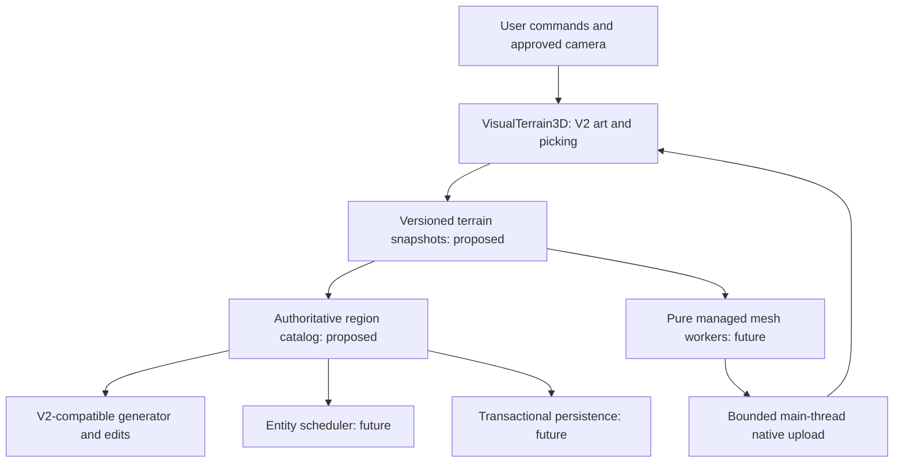
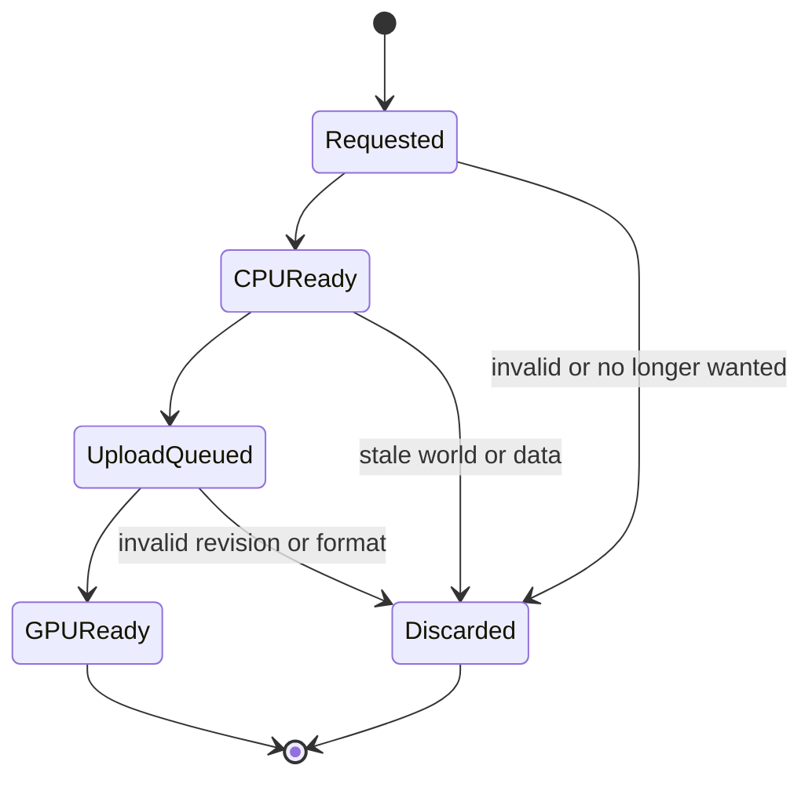

# V3 architecture — one visual pipeline, region-backed data

**Status:** target architecture (research + design), reviewed 2026-11-01. Existing source is explicitly identified; the remainder is **NOT IMPLEMENTED**. Superseding the following contracts requires a recorded ADR and the V2 parity evidence.

## 1. Known source snapshot

| Element | Current implementation | Owner / risk |
| --- | --- | --- |
| Visual scene | `Scenes/VisualLab3D.tscn`; `Scripts/VisualLab/VisualLab3D.cs` | Stable user-approved visual/UX foundation |
| Camera | `Scripts/Camera3D/StrategyCameraRig.cs`; terrain triangle DDA | Must remain the only pan/zoom/brush algorithm |
| Visual terrain | `Scripts/VisualLab/VisualTerrain3D.cs` 16×16 chunks, shared-corner fans, original shoreline shader, per-chunk Kenney batches | Reuse; *do not recreate separate second renderer* |
| Terrain authority | `WorldSim.WorldState` 120×88 single-array world, population and tools | Small-world authoritative gameplay; region migration pending |
| Opt-in parity data | `ITerrainTileSource`, `DirectWorldTerrainSource`, `RegionMirrorTerrainSource` (PR #49) | Second source is **cache of WorldState**, not independent huge world |
| Regional biome data | `WorldSim.Regions.RegionStore`, 64×64 byte cells with bounded LRU, sparse edits, snapshots / `BiomeRegionFiles` | Prototype generator differs from V2 art; must not blindly use |
| Regional elevation | `ElevationRegionStore`: 64×64 quantized signed height deltas at global corner positions, H:-based snapshot files | Live V2 integration for sculpt, not yet transactional whole-world save |
| World-scale preview | `RegionalWorldLab3D.tscn` at 8192² logical addresses | **WITHDRAWN / user-rejected** for missing terrain and camera/art regression |
| CI | Core .NET smoke tests + official Godot 4.7.2 Mono Linux scene boots | Necessary, cannot establish Windows FPS/visual quality |

## 2. Target dependency direction



The current WorldState/RegionMirror pair remains until authority migration passes. The diagram is the target dependency structure, not a list of existing modules. Scene/GPU state stays on the main thread. Data regions are 64×64; near display chunks are 16×16.

### Non-negotiable ownership

1. **Only one authoritative tile value.** During V3.3 WorldState is authority and RegionMirror is a strictly validated read cache. In V3.5 the versioned region store must be authority and WorldState replaced by an adapter for compatibility; never maintain two independently editable copies.
2. **Separate coordinate systems.** `CellCoord(long X,long Y)` and `RegionKey` are canonical logical positions. Render positions in Godot `Vector3` are **camera-relative** only when floating-origin work later justifies it (8192² floats can still be precise enough for one-unit tiles; verify). Convert through one well-tested transform.
3. **Logical partition vs display partition.** 64×64 persistent data regions ≠ 16×16 near-mesh chunks. Derive a separate dependency halo for each kernel: shared heights/colors, coast and picking. Current nonzero foam requires at least three input cells around a patch; texture filtering borders are a separate consideration.
4. **Data validity vs camera priority.** World identity/epoch changes on New World/load; region/chunk revision changes on edits; LOD/format identifies result compatibility. These are publication validity checks. CameraEpoch is a demand/priority hint: retain a result if its world/data/LOD are valid and its chunk is still wanted, even after a small pan. Cancel out-of-demand work beyond the retention margin. Avoid starvation from rejecting every job during continuous motion.
5. **No SceneTree off thread.** Workers may calculate arrays only. Native Godot scene objects, texture updates, array upload and shading changes remain on main thread. Use bounded queue and deterministic disposal.

## 3. Terrain generator and parity

**Problem discovered by PR #49:** the V3 RegionGenerator hash classifier yields different biomes from WorldState, even at identical world seed and position. A simple type adapter was not enough. The successful parity prototype samples the real V2 world as the baseline. To make regions truly authoritative:

- Extract V2 base terrain generation functionally. The audited formula is coordinate/hash based but its radial island falloff uses world width/height. Preserve explicit bounds and schema alongside seed and absolute coordinates. Audit subsequent coast/color/decor dependencies separately; do not assume a full-world generator rewrite is necessary.
- Preserve reference seeds (20261030 and 1315511732) for exact baseline screenshots, unless a separate user-approved world format version explicitly migrates the art.
- For deterministic generator: `CellCoord + Seed + WorldBounds + GenerationSchemaVersion` → terrain biome, elevation, decor seed. Region visitation/eviction order must not consume a global RNG stream. For older WorldState maps requiring global passes, provide a versioned migration and full comparison, not a silent change.
- Multi-region edits become commands over sorted authoritative regions with revision validation and localized rebuild. Remove hidden `_world.Tile` corner/color reads from the renderer during migration. Bound overrides, revision indexes, dirty queues and worker buffers in addition to resident LRU. Dirty eviction needs write-back/backpressure that preserves unsaved changes on I/O failure.
- Height vertices belong to one **absolute world lattice coordinate**, even when four adjacent cells or regions use that corner. Write authority consistently: no duplicates with independent rounding.

### Model simulation data sample (target, not implemented)

```csharp
record struct WorldId(Guid Value);
record struct ChunkKey(long X, long Y, int Lod);
record struct RegionRevision(ulong Value);
record struct RequestStamp(WorldId World, long WorldEpoch,
                           ChunkKey Chunk, RegionRevision Revision,
                           long CameraEpoch);
// Pure worker input: immutable byte[] biomes + short[] height halo;
// Pure worker output: Vertex[] + int[] indices + DecorationPlacement[].
// Godot array/mesh objects instantiated ONLY on the main thread.
```

A useful proof: generate an arbitrary edited region, unload it, generate unrelated regions, return, and compare exact terrain, coast and inhabitants against a never-evicted reference. Also compare rendering and picking across ±64 boundaries.

## 4. Streaming without blank geometry

**Rejected V3 flaw:** a 48 chunk cap removed tiles *without any fallback*. User sees holes; the camera feels disconnected as new chunks build slowly. Never repeat it.

Proposed state machine:



Check world/data/LOD validity before publication. A camera epoch change alone does not invalidate a still-desired compatible result. Measure queue wait and completion age during uninterrupted movement.

- A renderable **coarse** near/far proxy must exist for every screen-visible terrain/water position. If a detailed mesh isn't ready, show the proxy rather than the empty backdrop.
- Detail priority is screen-space error, camera proximity and current tool interaction, not blind FIFO.
- Rebuild dirty chunks once per edit burst; combine overlapping invalidations with halo/revision checks. Paint/sculpt/shore updates use the same bounded scheduling contract as newly visible chunks; current `FlushChanges` bypasses the new-chunk count limiter.
- Bound work by both **number** of chunks and *measured* milliseconds/bytes. Existing fixed `2 Eco/4 Balanced chunks per 50ms` is a starting control, not evidence of stable latency.
- Retain old visible geometry until a replacement is valid; avoid `QueueFree` of an old chunk before a replacement exists for that area.
- Workers use fixed capacity/coalesced desired work; cancel on world replacement/teardown, release arrays, and install only on the main thread. State machine tests must cover errors, stale results, cancellation and rapid reverse-camera travel.

### LOD modes for evaluation (not chosen as fixed numbers)

| Band | Representation | Rule |
| --- | --- | --- |
| Near LOD0 | existing 4-face fan mountain/slope, exact coast and authored tree/rock batches | Always match approved V2 at camera focus |
| Middle LOD1 | lower-density terrain with same biome palette/shore silhouette, less decoration | Must not lose coastline shape or create gaps |
| Far LOD2 | coarse topology and opaque sea with cheap local shoreline approximation | Always rendered instead of an empty cell |

Godot automatically-generated imported mesh LOD is for imported mesh assets and screen-space selection, **not** a guarantee of crack-free LOD transitions for runtime-generated terrain, nor of individual MultiMesh instance culling. Need deliberate terrain seam stitching/skirting and spatial MultiMesh splitting.

## 5. Coast and ocean

The current `WaterCoastMath.BuildMask(width,height,Tile,seed)` covers the entire **120×88** map. It allocates distance/type byte arrays and RGBA output. Scaling this unchanged to 8192² would allocate **384 MiB of array payload**, including **256 MiB output RGBA**, before image/native/GPU copies. This is a scale calculation, not current memory usage.

Use bounded regional coast patches with the same approved shader/colors and global wave/noise coordinates. Current foam weights are nonzero through Manhattan distance **3** from land; therefore a one/two-cell input halo is insufficient for exact patch parity. Preserve out-of-world behavior and calculate any additional texture filtering border. Other kernels retain independently derived halos.

Avoid full-world textures, full-image edit uploads, the rejected flat V3 sea replacement and costly transparency/reflection features in the baseline. Verify patched vs global mask bytes on reference worlds with land on patch boundaries; inspect water continuity and edits on Windows. A patch changes storage/sampling, not the approved water style.

## 6. Nature, mountain and people

- Current authored Kenney Nature Kit GLBs: 10 CC0 models under `Assets/Art/KenneyNature`. Each visible 16×16 chunk has separate species MultiMeshes so one giant forest isn't always drawn.
- PR #50 removed huge flat cap boulders from mountain tops; only conservative tall/embedded accent rocks on select lower slopes. Keep reference seed **1315511732** with the real mountain ridge.
- `NatureArtLibrary` should cache imported meshes/materials once, then compose per-chunk transforms. Future higher-quality Quaternius Standard models are **optional art experiments**, not drop-in replacement without measured GPU and style approval.
- `WorldState.People` currently drives a persistent MultiMesh; the future `EntityRegionStore` must maintain stable entity IDs and exactly-once cross-region ownership, bounded visible-instance buffers, deterministic fixed-tick simulation and save state. Separate logical simulation from render visibility (offscreen entities may still need summarized progression).
- A prototype with 8192² biome addresses but zero agents does **not** meet living-world product requirements.

## 7. Determinism, saves and failure recovery

Current region codecs are versioned/checksummed. Same-folder temporary replacement is an individual-file technique; it does not establish whole-world atomicity or unconditional power-loss durability. Before ADR 0005 is accepted, compare (A) immutable versioned region files with an atomic root manifest and (B) SQLite transactions. Evaluate native dependency/deployment, bounded writes, recovery, backups and measured save stalls. For option A, the proposed sequence is:

1. Stage modified region and entity snapshots under a new transaction ID.
2. Write/flush and verify every staged file, hashes and region references.
3. Write a new manifest referencing only validated staged objects; promote manifest atomically on same H: volume.
4. Only after successful manifest promotion may old generations be collected; retain last accepted manifest and backup.
5. Load by verifying schema, world ID, seed, hash, every region dependency and entity version **before mutating live world**.
6. Negative tests: crash after a subset written, missing files, corrupted checksum, wrong seed, interrupted load, duplicate entity ID, cross-version migration.
7. Specify filesystem/flush assumptions and test supported Windows storage. Retain previous valid generations; process-interruption tests alone are not hardware power-failure certification.

For SQLite, use explicit transactions and an intentional writer/timeout policy; do not assume multiple concurrent writers. Both options save world bounds, generator/schema/RNG versions, tick, event sequence and entity identity consistently. Network/cloud sync is not in scope.

## 8. Profiling and complexity budget

Do not use a one-second FPS HUD or mixed rolling diagnostics as final performance proof. The [implemented V3.3 runner](V3_3_ACCEPTANCE_RUNNER.md) captures isolated monotonic windows; F9 is now a rolling monotonic diagnostic, while old pre-runner CSVs contained engine delta. Follow ADR 0007: monotonic callback intervals, scenario timestamps and valid windows, plus separately measured stage durations/GC. Compare p50/p95/p99/max and stall counts. Godot's built-in script profiler does not profile C# scripts; use targeted managed counters and only then a compatible external profiler if needed. The Godot Mono Linux headless runner is a correctness/import gate, **not** a GPU benchmark for the old Windows AMD.

Suggested counters per frame: active regions, active detailed/fallback chunks, uncovered screen tiles, queued/stale/discarded meshes, bytes waiting upload, upload ms, chunk-build CPU ms, shader draw calls/triangles if measurable, people simulated vs drawn, per tick ms, heap/VRAM estimate. Preserve performance logs only on H:.

**Target** 30 FPS class at 1280×800 / Eco; initial p95 <=33.3 ms and no recurring >100ms stall are *provisional acceptance goals*, not measured current behavior. Always compare same seed/camera/zoom/window against approved V2 and report tradeoffs.

## 9. Exact architecture decisions required

- [ADR 0001](decisions/0001-preserve-v2-renderer-and-compatibility.md): keep single V2 renderer/camera, Compatibility tier, user visual gate.
- Planned ADR 0002: immutable region snapshots and authoritative procedural generator/versioning.
- Planned ADR 0003: bounded streaming queue, cancellation, main-thread native upload.
- Planned ADR 0004: cross-region canonical height + LOD seam strategy.
- Planned ADR 0005: transactional whole-world save, choosing immutable files/manifest vs SQLite after prototype evidence.
- Planned ADR 0006: regional population clock, versioned RNG, stable event order, interpolation and inactive-world semantics.
- [ADR 0007](decisions/0007-measurement-evidence-and-scenario-identity.md): accepted measurement/scenario contract; capture/fixture foundation implemented, physical acceptance pending.

## 10. Technical research

See [V3 technical evidence and rejected alternatives](V3_TECHNICAL_RESEARCH_2026.md). Never depend on unverified API availability from Godot "latest" development documentation without checking the exact 4.7.2 .NET runtime imported by CI.


## 11. Simulation, interpolation and navigation contract

The current 0.18-second custom tick and limited catch-up are not a regional-world clock contract. V3.6 must decide whether overload slows simulation or defers work, how offscreen regions advance, and how saved/replayed ticks preserve event order. Report dropped/deferred work explicitly. Do not change world history solely because the player moved the camera.

Use stable IDs, deterministic traversal and a versioned RNG algorithm/state per chosen domain. `System.Random(seed)` is useful for current same-runtime tests but is not guaranteed to produce the same sequence across major .NET versions. Generator version and simulation RNG version are distinct.

Render people from previous/current authoritative positions with an explicit interpolation fraction; clear history on teleport/spawn/world replacement. This is a custom simulation integration, not automatically solved by engine physics interpolation settings.

Prototype navigation from logical terrain snapshots with bounded query scheduling. Repath on meaningful goal/terrain revision changes, handle unreachable goals, test border transfer and avoid all-agent queries in one frame. Consider region-level routes plus local paths when measured need justifies the extra invalidation complexity. Detailed GPU meshes should not be the default navigation source; a Godot NavigationServer adapter remains an evaluated alternative while WorldSim stays engine-independent.
