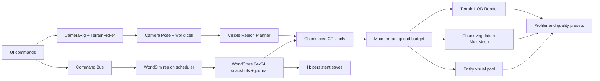

# ARCHITECTURE_DECISION — ADR-V2-001

**Status:** **Recommended / conditional**, not ratified in production.  
**Date:** 2026-10-30.  
**User goal:** not pure 2D, much higher visual standard than primitive low-poly, excellent world navigation, very large persistent evolving world.  
**Primary constraints:** existing C# deterministic core, Godot 4.7.2 .NET, R9 M395X running OpenGL Compatibility, all intentional project files/installs/caches/output on `H:\WorldForge-Sim`.

## Decision summary

**Select a Godot-native *hybrid-detail* 3D renderer:** authored stylized 3D terrain/props/people in the near camera region, progressively simplified 3D geometry with region-owned per-mesh-instance batching, and a strategic far/overview representation rendered from the **same authoritative chunked WorldStore**. Retain an orthographic Camera3D for initial UX; use a mathematically anchored pivot and optional constrained perspective mode only if tested. Keep the legacy 2D scene available as rollback.

Do **not** port to Unity or Unreal now: first prove premium art quality with coherent real assets and stable Godot camera, then benchmark hardware. Switching engines before a representative art/performance test would be speculative and high-risk.

This differs from "pure 2D". The near/medium visual layers are true 3D with depth, lighting and surfaces; simplified 2D only at extreme overview, like a minimap, is a scale technique, not the game's primary art direction.

## Weighted decision matrix (transparent expert judgment, NOT measured FPS)

Score: 1 poor → 5 favorable. Weights sum to 100%. "Legacy/compatibility" combines retention of existing WorldSim / existing Godot project and reliable rendering on old GPU. "Effort" score 5 means lower migration/rewrite risk.

| Evaluation | Weight | Godot hybrid 3D + far map | Godot all-distance detailed 3D | Godot 2.5D primary | Unity URP port | Unreal 5 port |
|---|---:|---:|---:|---:|---:|---:|
| Visual target | 25 | 5 | 5 | 3 | 5 | 5 |
| Large-world scale | 20 | 5 | 2 | 5 | 4 | 4 |
| Camera usability potential | 15 | 4 | 4 | 3 | 4 | 4 |
| Existing stack / old GPU | 15 | 4 | 4 | 5 | 2 | 1 |
| Performance control | 10 | 4 | 2 | 5 | 3 | 1 |
| Maintainability | 10 | 4 | 3 | 4 | 3 | 2 |
| Implementation/migration risk | 5 | 4 | 4 | 4 | 1 | 1 |
| **Weighted total / 500** | **100** | **445** | **355** | **405** | **360** | **315** |
| **Normalized / 100** | | **89** | **71** | **81** | **72** | **63** |

The matrix ranks strategic fit under user constraints, not verified engine performance. Change scores after running representative quality/performance bake-offs, not from marketing claims.

### Why not Unreal immediately?

Epic's recommended Unreal Engine 5 development machine includes 32GB RAM, 8GB+ VRAM and a DirectX12-class GPU. The GPU is older and actual available VRAM and feature level have not been validated; Unreal's C# integration also is not the first-class path for this repository. The current cost/risk is high relative to a narrow Camera+Art+Chunk prototype. [Epic official requirements](https://dev.epicgames.com/documentation/unreal-engine/hardware-and-software-specifications-for-unreal-engine).

### Why not Unity URP immediately?

Unity URP supports DX11/OpenGLCore/Vulkan and has strong tooling. It could be appropriate if **actual** authored-art side-by-side Godot comparison fails on shader compatibility or content workflow. But scenes, editor scripts, shaders, mesh APIs and input would all require migration; the pure `WorldSim` C# core could be adapted. No migration decision without proof. [Unity URP graphics API matrix](https://docs.unity.com/en-us/engine/6000.7/manual/render-pipelines/universal-render-pipeline/requirements).

### Why not simply enable Forward+?

Current Godot has shown Compatibility/OpenGL on AMD R9 M395X. Forward+ and Mobile require RenderingDevice-supporting APIs; Compatibility lacks key effects (SSR, SSIL, SDFGI, volumetric fog, decals) but **supports genuine attractive 3D** with authored art. Renderer feature tiers can be added after testing actual hardware. [Godot rendering feature matrix](https://docs.godotengine.org/en/stable/tutorials/rendering/renderers.html).

## Accepted design principles

1. **WorldSim authority, render freedom.** The simulation has logical cells/citizens and commands; terrain height, regional persistence and deterministic scheduling become explicit. A renderer never mutates `WorldSim` RNG by drawing a tree.
2. **WorldStore via immutable regional snapshots.** Default 64×64 logical data regions with versioned edit journal; no global data-array requirement.
3. **Camera anchor exactness above cosmetic smoothness.** Screen ray vs actual terrain, stable drag plane, correctness across zoom/pitch, input event separation; no reliance on flattened `Basis.Y`.
4. **Bounded active rendering.** Near 3D chunks and per-chunk MultiMesh + LOD, far aggregate region visuals, screen-space level thresholds, prefetch and main-thread upload budgets.
5. **Art quality through assets and materials first.** Commission/create original cliff/terrain art, import vetted coherent Quaternius CC0 glTF models with correct material/scale/LOD, and design water/lighting to fit Compatibility. Primitive sphere crowns are prototype placeholders, never accepted as final.
6. **Measured performance, not promises.** Host p95/p99 frame times, GPU process/memory and representative screenshots on R9 M395X. CI compilation is necessary but not sufficient.
7. **Reversible integration.** Keep separate new scene and H-only branch work until user visual evaluation; no destructive main-scene or `project.godot` mutation before final acceptance.

## Components and ownership

Potential interfaces:

- `IWorldStore.ReadRegionAsync(RegionKey)`, `IWorldStore.ApplyAsync(WorldCommand)`
- `IWorldRenderer.UpdateVisible(CameraPose)`, `Invalidate(RegionRevision)`
- `IChunkMeshBuilder.Build(RegionSnapshot, LodLevel)`: pure CPU buffer result, no Godot calls from workers
- `ITerrainPicker.TryPick(screenPx)`: exact hit and canonical cell
- `ICameraController.Consume(InputCommand)`: deterministic pose state and settings
- `IEntityPresentation.Update(EntityDeltaBatch)`: region-local transforms, no per-tick mesh resource recreation
- `IPerformanceProbe.Record(FrameSample)` with bounded buffers/logging to H:

## Chosen baseline technical settings — subject to measured validation

- **Renderer:** Godot Compatibility for R9 M395X; allow separate optional Forward+/Mobile quality tier only after hardware check.
- **Camera:** orthographic elevated rig, initial pitch ~40–55° and adjustable yaw; optional constrained long-lens perspective mode for later A/B, not MVP requirement.
- **Data regions:** 64×64 simulation cells with long coordinates, versioned journal and snapshot.
- **Visual mesh chunk:** start 32×32/64×64 A/B; per-LOD asset/material batches and one-cell halo.
- **World space:** canonical int64 tile/region coordinates; visual-origin-relative Godot float coordinate. Rebase threshold evidence-driven. No custom Godot double engine build yet.
- **Streaming:** pure CPU worker queue (bounded) and main-thread resource creation/upload budget, stale job cancellation.
- **Art:** high-quality near mesh with consistent material/LOD, mid simplified meshes, far impostors and strategic overview raster.
- **GPU budget:** choose from measured process/driver constraints; no invented VRAM limit.
- **World QA:** seed determinism, region seams, repeated save/restore, zoom anchor and latency tests.

## Explicitly unresolved

- Actual Godot 3D screen performance on R9 M395X at 1280×800 with licensed models.
- Which art/terrain kit delivers highest coherent production quality; Quaternius Standard excludes some Source assets/shaders.
- Shader import/texture format and asset normalization for the actual Quaternius downloaded ZIP.
- Exact brush semantics when continuous elevations replace discrete height labels.
- Chunk sizes, target resident memory/LOD distances and floating-origin threshold pending profiling.
- If editor hang issue #12 is driver/editor problem, do not attribute it to runtime renderer prematurely.

## Review / rejection criteria

Reconsider engine selection if a fixed 64×64 authored-art slice on Godot suffers **reproducible** compatibility failures, unacceptable p95/p99 even after chunk batching/quality tiers, or a material/art pipeline limitation materially preventing desired look; then build the identical slice in Unity URP and compare **measured** output, engineering maintenance and licensing costs. Do not migrate based on generic screenshots.

**Decision gate:** user approves the 3D visual style and navigation in an actual standalone H:-based build, plus deterministic tests and baseline metrics. Until then, this ADR remains conditional and previous fallback scenes stay playable.
