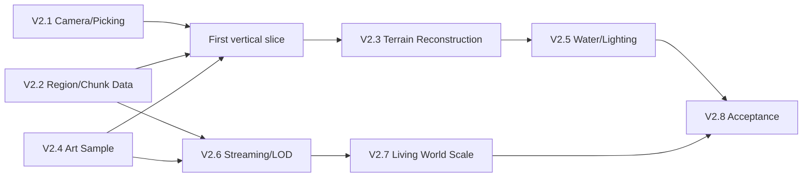

# IMPLEMENTATION_ROADMAP — V2 redesign with measurable release gates

**This is a development plan, not implementation completion.** The user wants a beautiful true 3D world, a correct camera, and a world that can become orders of magnitude larger. Do **not** build new cosmetic water effects ahead of camera, region boundaries and stable art direction.

**Source audit:** [CURRENT_STATE_AUDIT](CURRENT_STATE_AUDIT.md)  
**Decision:** [ARCHITECTURE_DECISION](ARCHITECTURE_DECISION.md)  
**First demonstrator:** [FIRST_VERTICAL_SLICE](FIRST_VERTICAL_SLICE.md)

## Workstream ordering



Order nuance: the first **art sample** begins after camera contracts are stable but **before** a massive renderer rewrite; don't spend weeks replacing mesh generation without proving the art target. V2.2 region interfaces can be worked on in parallel with V2.1 because the old 2D/V2 scene is not modified until tested.

## Global development and merge rules

- **Branch per scoped task, PR per branch**. Each PR references issue, owner, dependencies, risk, benchmark results, screenshots and rollback path.
- CI should compile **actual Godot C#** and run deterministic `WorldSim` + camera + region math tests. Runtime/shader import must be tested separately (prefer standalone).
- The user's Windows `H:\WorldForge-Sim` is the final hardware verification location. NEVER intentionally use C: for project files, downloads, dependencies, temp/caches or benchmarks. Respect locally modified `project.godot`.
- PR may be implemented with source/CI green but remain Draft until actual Windows camera, screenshots and performance acceptance. User previously authorized merge *once the gate passes*; no assumption that an untested rendering change is safe.
- Preserve old `Scenes/Main.tscn` and opt-in `Scenes/VisualLab3D.tscn` until V2 visual acceptance; do not force-set `run/main_scene`.
- Update `docs/PROJECT_STATE.md` with observed facts, missing measurements, failures, reproducibility details and exact commit hashes.

## Milestones and gates

| Stage / relative effort | Engineering objective and major files | Depends on | Deliverable and acceptance | Rollback and risk |
|---|---|---|---|---|
| **V2.1 Camera & Picking — M** | `Scripts/Camera3D/{CameraPose,DragMath,StrategyCameraRig,TerrainPicker}.cs`; `VisualLab3D.cs` input dispatch; `tests/Camera3D.Smoke` | existing V2 | Ground-ray drag stable, cursor-anchored zoom on elevated terrain, correct brush selection; CAM-01..12 tests, 20 sec drag latency profile + user feel approval | Feature toggle to old camera; danger: input math and terrain intersection precision |
| **V2.2 Region/Chunk Model — L** | New `src/WorldSim/Regions/{RegionKey,RegionSnapshot,IWorldStore,Commands,RegionCache}.cs`; `tests/WorldRegion.Smoke` | stable simulation seed, command design | 64×64 region snapshots, deterministic cross-region editing and reload, 128² demo without full-world redraw; 512² data-only stress | New store behind adapter; old `WorldState` remains reference; deterministic replay risk |
| **V2.3 Terrain Geometry — L** | `Scripts/Rendering3D/{ChunkMeshBuilder,HeightSampler,SurfaceMaterialAtlas,CliffGenerator}.cs` | V2.2 and approved art sample | Non-binary elevation, edge-consistent cliffs/slope, material blending and exact picking; no cracks at chunk borders, local edit rebuild only | Switch scenes to old VisualLab; risk: seams, collision mismatch |
| **V2.4 Professional Art — M/L** | `Assets/ArtSource` (H-local), `Assets/Nature` (H-local provenance), `scripts/import-*.ps1`, stylized materials/LOD; curated demo | V2.1 + licensing | 2+ coherent tree species, rocks, brush/flowers, near/mid LOD, visual screenshot comparison at 3 zooms, user signs off appearance | Fallback placeholder models; risk: license mismatch, materials unsupported, overly expensive geometry |
| **V2.5 Water/Lighting — M** | `Assets/Shaders`, shore mask/normal/wave materials, sun/shadow quality presets | V2.3/4 | Natural color/foam/shore behavior at all elevations; Compatibility-safe shader compiled/ran; shadow ON/OFF performance and visual approval | Shader/material quality tier toggle; risk: old GPU shader cost |
| **V2.6 Large-World Streaming — XL** | `Scripts/Streaming/{VisibilityPlanner,ChunkJobQueue,MainThreadCommit,ChunkCache,LODController}.cs` + new WorldStore | V2.2/3/4 | 512² → 2048² → 4096² → 8192² sparse-load stress; visible/resident resources bounded; no long teleports stutter; p95/p99 and memory curves documented | Disable large maps / old small world mode; risk: concurrency, stale uploads and seams |
| **V2.7 Living-World Presentation — XL** | `WorldSim` region active/coarse scheduler, `Scripts/Entities/{EntityPresentation,RegionalBatches}.cs`, animation assets | V2.6 | 1k/10k visible+background citizens, no new Mesh per entity tick, deterministic reconciliation, settlements later | Activate small simulation fallback; risk: simulation divergence |
| **V2.8 Release & QA — M/L** | H:-based benchmark scripts, reproducible host artifacts, CI/QA dashboards | all relevant phases | Visual user sign-off, gameplay regression, shader import and save/restore validation, 30/60 FPS tier decided from evidence | Revert individual PR/scene toggle, retain old save version until migration validated |

Relative effort guide: **S** <= one isolated component; **M** multiple related components; **L** cross-layer change with integration; **XL** major architecture + profiling. These are *relative* effort categories, not delivery date promises.

## First three engineering priorities (recommended order)

### Priority 1 — Make camera navigation correct, then pleasant

**Branch:** `feat/v2-camera-ray-anchored`  
**Issue:** new issue linked to #19, #17; suggested `[V2.1] Correct camera drag/zoom/terrain picking`.

Tasks:
- Extract camera input/controller and pure math to `Scripts/Camera3D`.
- Implement exact screen-ray-to-reference-plane intersection for drag.
- Zoom anchor at real surface hit; optional pitch/yaw controls and keyboard pan with screen-speed normalization.
- Replace 0.22-step long-distance CPU raymarch with an indexed terrain hit in current loaded chunks.
- Record input-to-render frame traces; test at 1280×800 and 1920×1080.
- Preserve gameplay commands/HUD and existing VisualLab alternative until user accepts.

Gate: CAM-01..12, user confirms drag and zoom no longer feel wrong, tested in stand-alone game. No forced smoothness.

### Priority 2 — Set a region-aware data boundary before world expansion

**Branch:** `feat/v2-world-region-contract`  
**Issue:** proposed `[V2.2] Deterministic WorldStore region snapshots`.

Tasks:
- New 64×64 `RegionKey`, `CellCoord(long)`, `RegionSnapshot`, `IWorldStore` and `WorldCommand`.
- Seed-stable data generation independent of creation/load order, including negative coord floor division.
- Serialize/restore region data and a small edit journal on H:; at least 4 adjacent regions in 128×128 test.
- Adapt existing 120×88 world to new interface without changing user tools; add exact cross-region brush tests.
- Benchmark memory/load at 512² data-only; do **not** instantiate all 3D chunks.

Gate: deterministic checksum and reload, multi-region edits correct, no unwanted Godot dependencies in WorldSim. Regression fallback intact.

### Priority 3 — Produce one **beautiful**, coherent 3D art scene

**Branch:** `feat/v2-authored-nature-slice`  
**Issue:** proposed `[V2.4] Authored nature art vertical slice and asset pipeline`.

Tasks:
- Inspect actual Quaternius Standard source archive on H:, verify formats and license; support .gltf dependencies as needed (not merely file renaming to .glb).
- Curate 2+ detailed tree types, 1+ rock families, shrubs/flowers, terrain blending and a coastline. Normalize pivots/scale, material count, draw calls, and near/mid LOD variants.
- Use Compatibility-friendly materials/lighting and test R9 M395X; measure p95/p99 and screen composition.
- Capture same seed/camera at regional/village/close zoom before/after. Have user evaluate **style**, not just performance.

Gate: actual artwork recognizably higher quality and approved by user; no acceptance if it merely changes flat colors or uses primitive spheres.

## Feature-level work packages and dependencies

| ID | Implementation | Automated verification | Manual verification |
|---|---|---|---|
| CAM-A | Ground-ray drag with frozen anchor plane | Camera math screen-to-world differential property tests | 100px horizontal and vertical grabs feel symmetric |
| CAM-B | Terrain-based zoom/cursor preservation | Reproject world anchor under zoom unit test | Forest/mountain under cursor at all zoom levels |
| CAM-C | Indexed picking | Known terrain/height collision hit tests | Brush accurate on elevated cliffs |
| WORLD-A | Canonical region serialization/version | deterministic SHA checks and crash replay | reload user-edited 128² world |
| WORLD-B | Bounded visible region cache | resident count, eviction/reload test | fast pan between opposite corners |
| ART-A | Model provenance and normalization | importer validates material/pivot/texture dependencies | curated 3-distance screenshots |
| TERRAIN-A | Shared border normals/height | seam equality at 4 adjacent chunks | no cracks when zooming/LOD switches |
| STREAM-A | Cancellation + main-thread budgets | stale revision cancellation test | no frame spike after teleport |
| SIM-A | Visible entity batches | regional population movement determinism | 1k/10k multi-region stress |
| QA-A | Frame-time ring and metadata exporter | percentile math test with synthetic samples | real p95/p99 and GPU data if available |

## Performance and memory gates

**Before measuring on the Windows host**, reject numeric promises. Initial targets to investigate:

- 1280×800 **Compatibility** and eventual modern-GPU tier separately.
- Smooth reference camera interaction at 30/60 FPS; aspirational 60 FPS has 16.67ms budget, stable 30 FPS 33.33ms. Measure p95/p99, not average alone.
- Main-thread chunk upload and mesh-commit budget derived from measured worst-frame spikes; freeze/teleport should not cause unbounded queue growth.
- Memory/VRAM: derive from actual R9 M395X capability/driver and resident-region counts.
- Full-world 8192² test: **bounded sparse region residency**; forbid allocating or rendering all cells on the GPU.

## Documents / PR completion template

For each PR add:

```text
Issue / branch / base / SHA:
Before/after captured seed, viewport, camera:
Core smoke / targeted smoke:
Godot C# CI:
Standalone Windows game result:
FPS avg/p95/p99, worst frame and source:
CPU/RAM/GPU monitor:
Relevant screenshots and input replay:
No C: intentional writes confirmed:
Local changes in project.godot preserved:
Risks, fallback mode and deferred problems:
Approver outcome:
```

When outcomes are missing, write **NOT TESTED**, not PASS. Do not merge a visually destructive default-scene switch while the target remains rejected.

## Additional dependency: Editor freeze

Issue #12 is a distinct Godot editor responsiveness problem. Test it with game embedding disabled and on a clean H:-based portable installation. Do not conflate editor hangs with standalone runtime performance or spend V2 budgets on an unproven fix.

## After the first vertical slice

Make an explicit gate decision:
- Camera feels right **and** the authored 3D art is approved **and** performance is measured → scale and migrate progressively.
- Camera works but art fails → iterate assets/materials before architecture polishing.
- Art is good but renderer too slow → profile LOD/shadows/batching in Compatibility before considering engine migration.
- Persistent platform limitation → build same slice in Unity URP for measured comparative trial; don't scrap simulation code prematurely.
